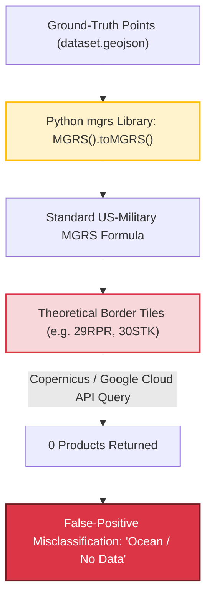

# Technical Debt & Architecture Discrepancies

This document catalogs the technical debt identified across **LandCoverPy**, the root causes behind library discrepancies (specifically geospatial tiling differences), and the modernization steps applied to dependencies and packaging.

---

## 1. Geospatial Discrepancy: Mathematical MGRS vs. Official ESA Sentinel-2 Tiling Grid

### Context & Symptom
During continental-scale extraction across the Mediterranean Basin, 32 tile codes (e.g., `29RPR`, `30STK`, `31TBH`, `32RNA`, `35SPE`) consistently returned **0 acquisitions** from the Copernicus Open Access Hub and Google Cloud Sentinel-2 APIs, leading automated audit scripts to erroneously label them as *"open ocean / no-data"*. Furthermore, these tiles could not be found in tools like *Sentinel-2 Grid Explorer* or the official Copernicus catalog.



### Root Cause
In `src/landcoverpy/utilities/geometries.py`, the function `_group_validated_data_points_by_tile` converts spatial points into tile IDs using the Python `mgrs` library:
```python
# src/landcoverpy/utilities/geometries.py
def _get_mgrs_from_geometry(geometry: dict):
    tiles = set()
    corners = _get_corners_geometry(geometry)
    for point in corners.values():
        tiles.add(MGRS().toMGRS(*point, MGRSPrecision=0))
    return tiles
```

* **Standard Military MGRS:** Computes fixed mathematical $100\text{ km} \times 100\text{ km}$ UTM grid cells purely from latitude and longitude formulas.
* **ESA Sentinel-2 Tiling Grid:** Although derived from MGRS, the European Space Agency (ESA) defined a customized, mission-specific tiling grid. Along UTM zone boundaries and latitude band junctions, the ESA **does not instantiate every mathematical MGRS code**. Instead, ESA merges or absorbs border areas into neighboring official tiles (e.g., points that mathematically calculate to `29RPR` are physically captured under ESA tile `29RPP`).

### Impact
* **Grid Count Inflation:** The canonical grid defined in `docker-compose.yaml` contains **487 valid Sentinel-2 tiles**. Unioning the output of `mgrs.toMGRS()` inflated the list to **540 codes**, introducing 32 "phantom" tiles that have no satellite passes.
* **Phantom Missing Tiles:** Audits looking for these 32 codes flagged them as incomplete or missing, when in reality no Sentinel-2 data ever existed for those identifiers.

### Resolution & Best Practice
1. **Never use mathematical coordinate-to-MGRS formulas to deduce Sentinel-2 tiles.**
2. **Spatial Join against Official Footprints:** Load the official ESA Sentinel-2 Tiling Grid vector polygon layer (`S2A_OPER_GIP_TILPAR_...` GeoJSON/Shapefile) and perform a geometric intersection:
   ```python
   # Recommended approach
   import geopandas as gpd

   points_gdf = gpd.read_file("dataset.geojson")
   s2_grid_gdf = gpd.read_file("sentinel2_official_grid.geojson")
   matched_gdf = gpd.sjoin(points_gdf, s2_grid_gdf[["tile_id", "geometry"]], predicate="within")
   ```
3. **Canonical Reference:** The ground truth for processing must always be the explicit list of official tiles (such as `TILES_TO_PREDICT` in `docker-compose.yaml`).

---

## 2. Dependency Modernization & Security Vulnerabilities

### Branch Reference: `feat/modern-packaging-uv` (Commit `d97e646`)
To eliminate legacy packaging debt and address automated security advisories (Dependabot CVEs), dependency specifications were upgraded on the dedicated reference branch `feat/modern-packaging-uv`.

### Addressed Technical Debt Items

| Area | Legacy State | Modernized State (`feat/modern-packaging-uv`) | Rationale / Benefits |
| :--- | :--- | :--- | :--- |
| **Packaging Spec** | Legacy `setup.cfg` + `setup.py` | Modern `pyproject.toml` (PEP 517 / PEP 621 via Hatchling) | Adheres to modern Python packaging standards; eliminates setuptools deprecation warnings. |
| **Package Manager** | Classic `pip` with unpinned sub-dependencies | `uv` (Fast Astral package manager) + `uv.lock` | Generates a deterministic, cryptographically hashed `uv.lock` file; installs dependencies in $< 1\text{ s}$. |
| **Network & SSL** | Outdated `requests` and `urllib3` $< 2.0$ | Updated to `requests >= 2.31.0`, `urllib3 >= 2.2.2`, `certifi >= 2024.7.4` | Patches known vulnerabilities: CVE-2023-32681, CVE-2023-45803, CVE-2024-37891. |
| **Configuration** | `pydantic v1` (`_Settings`) | Upgraded to `pydantic >= 2.7.0` and `pydantic-settings` | Resolves schema validation deprecations and improves environment variable parsing performance. |
| **Scientific Stack** | Unpinned `numpy`, `rasterio`, `geopandas`, `shapely` | Explicit bounds pinned to compatible GDAL/PROJ versions | Prevents ABI breakage between host GDAL C-libraries and PyPI binary wheels. |

---

## 3. Database Schema Drift (MongoDB Composites Collection)

### Problem
Across pipeline iterations, documents in MongoDB collection `composites` experienced schema drift:
* **Legacy pipeline documents (706 records):** Stored season metadata under:
  ```json
  { "period": "seasonal", "periodLabel": "spring", "compositeMethod": "mean" }
  ```
* **Modern download pipeline documents (1,778 records):** Stored season metadata under:
  ```json
  { "season": "spring", "year": 2021, "compositeMethod": "median" }
  ```

### Impact
Queries filtering strictly on `col.count_documents({'season': 'spring'})` only counted the 425 modern documents, omitting the 473 legacy records and causing false reports of missing composites.

### Resolution Applied
A non-destructive backfill migration was executed across all 2,484 composite documents to ensure dual-key consistency:
* Documents with only `periodLabel` were updated to include `season = periodLabel`.
* Documents with only `season` were updated to include `periodLabel = season`.
* Any query using either `'season'` or `'periodLabel'` now reliably returns 100% of available composites.

---

## 4. Network Concurrency & Socket Saturation

### Problem
When processing hundreds of tiles over several months, workers made tens of thousands of rapid HTTP/REST queries to Copernicus Dataspace and Google Cloud Storage APIs. In Linux and WSL2 environments, unmanaged connections created thousands of short-lived TCP sockets in `TIME_WAIT` status, eventually triggering:
```text
requests.exceptions.ConnectionError: ('Connection aborted.', OSError(99, 'Cannot assign requested address'))
```

### Resolution Applied
* Implemented a global `requests.Session` with `HTTPAdapter` connection pooling:
  ```python
  adapter = HTTPAdapter(pool_connections=25, pool_maxsize=25, max_retries=retry_strategy)
  session.mount("https://", adapter)
  ```
* Added automatic socket cooldown periods (180 seconds pause and session reset) upon detecting connection exhaustion.

---

## 5. Storage Leaks & Raw Product Retention (MinIO)

### Problem
Each Sentinel-2 tile acquisition contains 14 raw band rasters totaling $1.2\text{ GB} - 2.5\text{ GB}$. Downloading 20 captures per tile and keeping them in the `s2-products` bucket consumed over $20\text{ GB} - 40\text{ GB}$ per tile. Across hundreds of tiles, storage quickly exhausted available disk space (especially under WSL2 virtual disks capped at 1 TB).

### Resolution Applied
* **Immediate Post-Composite Purge:** As soon as a composite and its spectral indices are uploaded and verified in `s2-composites`, all corresponding raw products in `s2-products` are purged using high-throughput batch deletion (`minio.deleteobjects.DeleteObject`).
* **MongoDB Memory Cleanup:** Heavy intermediate raster arrays (`indexes`, `intermediateProducts`) are unset from raw product records in MongoDB via `update_many`, retaining only the lightweight core metadata (title, sensing timestamp, cloud cover, bounding footprint).

